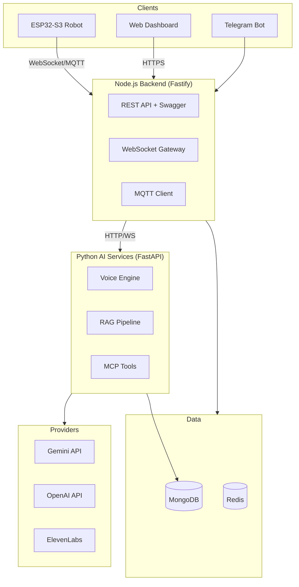

# 🤖 AI Voice Assistant Robot Platform

> A scalable, modular, production-ready AI Voice Assistant Robot Backend connecting ESP32-S3 AI robots, web dashboards, and AI voice conversation systems.

## Architecture



## Prerequisites

- **Node.js** >= 20.0.0
- **Python** >= 3.11
- **Docker** & Docker Compose
- **MongoDB** 7+
- **Redis** 7+

## Quick Start

```bash
# 1. Clone the repository
git clone <repo-url> ai-robot-platform
cd ai-robot-platform

# 2. Copy environment config
cp .env.example .env
# Edit .env with your API keys and settings

# 3. Start with Docker (recommended)
docker compose -f docker-compose.yml -f docker-compose.dev.yml up --build

# OR start services individually:

# 4a. Install dependencies
npm install

# 4b. Build shared packages
npm run build --workspace=packages/shared-types

# 4c. Start backend
npm run dev

# 4d. Start AI services
npm run dev:ai
```

## Project Structure

```
ai-robot-platform/
├── apps/
│   ├── backend/          # Node.js Fastify backend
│   │   ├── src/
│   │   │   ├── config/       # Configuration & connections
│   │   │   ├── modules/      # Feature modules
│   │   │   ├── plugins/      # Fastify plugins
│   │   │   ├── middleware/    # Auth, validation, errors
│   │   │   ├── shared/       # Base classes, errors, utils
│   │   │   ├── websocket/    # Socket.IO gateway
│   │   │   ├── mqtt/         # MQTT broker & client
│   │   │   ├── jobs/         # Background job processors
│   │   │   └── utils/        # Helpers & utilities
│   │   ├── tests/
│   │   └── Dockerfile
│   └── ai-services/      # Python FastAPI AI microservices
│       ├── app/
│       │   ├── api/          # API routes
│       │   ├── core/         # Core config
│       │   ├── providers/    # AI provider adapters
│       │   ├── voice/        # Voice engine
│       │   ├── rag/          # RAG pipeline
│       │   └── mcp/          # MCP tool server
│       ├── tests/
│       └── Dockerfile
├── packages/
│   ├── shared-types/     # Shared TypeScript types
│   └── api-contracts/    # API contract definitions
├── infrastructure/
│   ├── docker/           # Docker configs
│   ├── nginx/            # Nginx reverse proxy
│   └── scripts/          # Deployment scripts
├── docs/                 # Documentation
├── frontend/             # Future React/Next.js frontend
├── docker-compose.yml
├── .env.example
└── README.md
```

## Available Scripts

| Script | Description |
|--------|-------------|
| `npm run dev` | Start backend in development mode |
| `npm run dev:ai` | Start Python AI services |
| `npm run build` | Build all packages |
| `npm run test` | Run all tests |
| `npm run docker:dev` | Start all services with Docker (dev) |
| `npm run docker:prod` | Start all services with Docker (prod) |
| `npm run docker:down` | Stop Docker services |
| `npm run clean` | Clean all build artifacts |

## API Documentation

Once running, visit: **http://localhost:3000/api/docs**

## Documentation

- [Architecture Guide](docs/ARCHITECTURE.md)
- [API Documentation](docs/API_DOCUMENTATION.md)
- [ESP32 Integration](docs/ESP32_INTEGRATION.md)
- [AI Integration](docs/AI_INTEGRATION.md)
- [MCP Integration](docs/MCP_INTEGRATION.md)
- [Database Schema](docs/DATABASE_SCHEMA.md)
- [AWS Deployment](docs/DEPLOYMENT_AWS.md)
- [Firmware Integration](docs/firmware-integration.md)

## License

MIT

