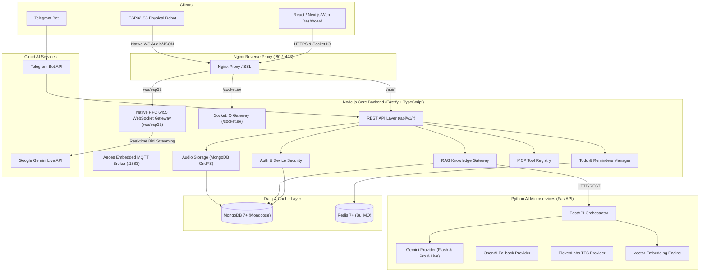

# AI Voice Assistant Robot Platform — Architecture Guide

## 1. System Architecture Overview

The platform connects physical ESP32-S3 robots, Web Dashboards, and AI Voice systems through a decoupled microservice architecture:

---

## 2. Real-Time Communication Protocols

### Layer 1: ESP32-S3 ↔ Backend
- **Protocol:** Native RFC 6455 WebSocket (`ws://` / `wss://`)
- **Route:** `/ws/esp32`
- **Audio Framing:** Raw binary frames (16kHz 16-bit PCM). Zero packaging overhead.
- **Control Framing:** Lightweight JSON text frames (`device:heartbeat`, `touch:event`, `robot:command`).
- **Why NOT Socket.IO?** Microcontrollers have strict memory (RAM) and CPU limits. RFC 6455 avoids the Socket.IO polling fallback, ping/pong JSON framing, and packet fragmentation overhead.

### Layer 2: Web Dashboard ↔ Backend
- **Protocol:** Socket.IO
- **Route:** `/socket.io/`
- **Rooms:** `user:<userId>`, `device:<deviceId>`, `conversation:<conversationId>`
- **Events:** `device:status`, `robot:state` (idle, listening, thinking, speaking), `robot:touch`, `audio:transcription`, `reminder:triggered`.
- **Purpose:** Powers real-time state visualization, remote teleoperation, live transcriptions, and notification popups on modern browsers.

### Layer 3: Backend ↔ Gemini Live API
- **Protocol:** Gemini Multimodal Bidi WebSocket (`BidiGenerateContent`)
- **Latency Strategy:** Audio chunks from ESP32 are immediately forwarded without waiting for complete recording sentences.
- **Barge-in / Interruption:** When Gemini Live server detects incoming user speech during playback, it sends an `interrupted` signal. The backend immediately dispatches `audio:cancel` to the robot to halt audio playback instantaneously.

---

## 3. Storage Architecture

| Data Type | Storage Engine | Strategy |
|---|---|---|
| Users & Devices | MongoDB Collections | Document index on `email`, `macAddress` |
| Tasks & Reminders | MongoDB Collections | TTL, compound indexes on `userId` + `status` |
| Audio Recordings | MongoDB GridFS | Segmented 255KB chunks, streaming with HTTP 206 Partial Content |
| Vector Chunks | MongoDB Atlas Vector Search | 768-dimension cosine similarity index with keyword fallback |
| Job Queues | Redis (BullMQ) | Persistent delayed jobs for reminder notifications |
