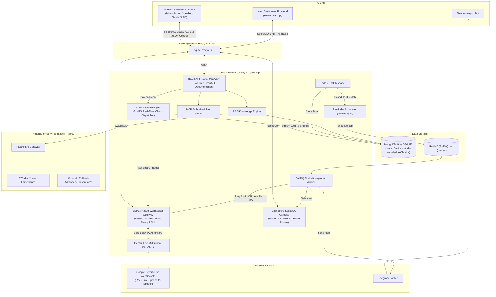

# AI Voice Assistant Robot Platform — Backend System Master Overview

> **Version:** 1.0.0 Production-Ready  
> **Architecture:** Clean Architecture (Routes → Controller → Service → Repository)  
> **Core Framework:** Node.js 22 LTS, Fastify 5, TypeScript 5, Python 3.12, FastAPI  
> **Databases:** MongoDB Atlas / Local MongoDB 7.0 (Mongoose 8, GridFS), Redis 7.0 (BullMQ)  
> **Real-Time Layers:** Native RFC 6455 WebSocket (ESP32-S3), Socket.IO (Web Dashboard)  

---

## 1. System Architecture & High-Speed Data Flows



---

## 2. Key Features & Low-Latency Implementations

### A. Real-Time Audio Playback on Robot from Website
- **Website Trigger:** User clicks "Play" on any recorded conversation or uploaded sound in the audio library.
- **Backend Flow:**
  1. `POST /api/v1/audio/:id/play-on-device` is invoked.
  2. Backend verifies ownership and checks if the robot is currently connected via native WebSocket (`getActiveEsp32Session(deviceId)`).
  3. Backend dispatches `audio:response:start` with sample rate and codec.
  4. The audio stream is read from MongoDB GridFS and piped **directly as raw binary WebSocket frames (RFC 6455 `0x2`)** to the ESP32 in 4096-byte slices.
  5. **Latency:** Streaming begins within **< 50 milliseconds**. No intermediate buffering or temporary file conversion.
  6. When finished or interrupted, `audio:response:end` or `audio:cancel` is emitted.

### B. Todo List, Telegram Notification & Physical Robot Alarm
- **Website Trigger:** User creates a Todo item or Reminder with a due date/time (`dueDate`).
- **Backend Flow:**
  1. Todo is saved to MongoDB.
  2. A delayed job is automatically registered in **BullMQ (Redis)** with the exact millisecond delay (no unstable `setTimeout`).
  3. When the due timestamp arrives:
     - **Telegram Notification:** Sent instantly to the user's linked Telegram chat with task details and alert sound.
     - **Dashboard Socket.IO Alert:** Real-time modal and audio notification on the web browser.
     - **Physical Robot Ringing Alarm ("ထမြည်ရမယ်"):** If the robot is powered on and connected to Wi-Fi/WebSocket, the backend:
       - Sends `reminder:alert` event with `playAlarm: true`.
       - Generates a dual-tone 16-bit 16kHz audio alarm chime buffer.
       - Streams the chime directly to the robot speaker.
       - Pulses the NeoPixel LED to alert the user visually.

### C. Low-Latency AI Voice Engine (Gemini Live)
- **Bidirectional Speech-to-Speech:** Direct communication with Google Gemini Live API.
- **Barge-in / Interruption:** When the user speaks while the robot is talking, Gemini detects speech and sends an `interrupted` packet. The backend immediately cancels robot speaker playback via `audio:cancel`.

---

## 3. Complete REST API Specifications

All endpoints are prefixed with `/api/v1` and documented interactively via Swagger at `http://localhost:3000/api/docs`.

| Module | Method | Endpoint | Description |
|---|---|---|---|
| **Auth** | `POST` | `/auth/register` | Register new user account & generate default settings |
| | `POST` | `/auth/login` | Login with email/password; returns access & refresh tokens |
| | `POST` | `/auth/refresh` | Rotate JWT access token securely |
| | `POST` | `/auth/logout` | Invalidate active refresh tokens |
| | `POST` | `/auth/change-password` | Update account password |
| **Users** | `GET` | `/users/profile` | Get logged-in user profile |
| | `PATCH` | `/users/profile` | Update profile preferences (name, language, timezone) |
| | `POST` | `/users/telegram/link` | Link Telegram Bot Chat ID for alerts |
| | `POST` | `/users/telegram/unlink` | Unlink Telegram account |
| **Devices** | `POST` | `/devices/register` | Register an ESP32-S3 robot; generates secret `apiKey` |
| | `GET` | `/devices` | List all user robots and online/offline status |
| | `GET` | `/devices/:id` | Get robot capabilities and hardware telemetry |
| | `PATCH` | `/devices/:id/config` | Update robot hardware configuration |
| | `DELETE` | `/devices/:id` | Remove / unregister device |
| **Audio** | `GET` | `/audio` | List audio recordings with date/type/device filtering |
| | `GET` | `/audio/:id` | Get audio metadata (duration, sample rate, codec, size) |
| | `GET` | `/audio/:id/stream` | Stream audio with HTTP 206 Partial Content (Range request) |
| | `POST` | `/audio/:id/play-on-device` | **Stream database audio directly to robot speaker** |
| | `POST` | `/audio/stop-on-device` | **Stop / silence robot speaker playback immediately** |
| | `DELETE` | `/audio/:id` | Delete audio file and clean up GridFS chunks |
| **Todo** | `POST` | `/todo` | Create new task (auto-schedules alarm if `dueDate` set) |
| | `GET` | `/todo` | List tasks with filters (pending, completed, priority) |
| | `GET` | `/todo/:id` | Get todo details |
| | `PATCH` | `/todo/:id` | Update todo title, description, or due date |
| | `POST` | `/todo/:id/complete` | Mark todo as done (automatically clears pending alarm) |
| | `DELETE` | `/todo/:id` | Delete todo |
| **Reminders** | `POST` | `/reminders` | Schedule reminder with timezone (Asia/Yangon) & recurrence |
| | `GET` | `/reminders` | List scheduled reminders |
| | `GET` | `/reminders/:id` | Get reminder details |
| | `PATCH` | `/reminders/:id` | Reschedule reminder |
| | `DELETE` | `/reminders/:id` | Cancel reminder and BullMQ job |
| **Settings** | `GET` | `/settings/user` | Get user AI preferences & quiet hours |
| | `PATCH` | `/settings/user` | Update AI personality, models, temperature |
| | `GET` | `/settings/device/:deviceId` | Get robot voice, sound, display hardware settings |
| | `PATCH` | `/settings/device/:deviceId` | **Adjust volume/brightness with instant robot sync** |
| **Knowledge** | `POST` | `/knowledge` | Upload text or document to RAG knowledge base |
| | `GET` | `/knowledge/search` | Semantic vector search across user documents |
| | `GET` | `/knowledge` | List indexed knowledge documents |
| | `DELETE` | `/knowledge/:id` | Delete document and vector chunks |
| **MCP** | `GET` | `/mcp/tools` | List registered MCP tools and JSON schemas |
| | `POST` | `/mcp/execute` | Execute authorized MCP tool with audit logging |
| | `GET` | `/mcp/logs` | View tool execution audit trail |
| **Conversations** | `POST` | `/conversations` | Start new conversation session |
| | `GET` | `/conversations` | List conversation history |
| | `GET` | `/conversations/:id/messages`| Get message turns, token counts, and latencies |
| | `DELETE` | `/conversations/:id` | Delete conversation |
| **Notifications** | `GET` | `/notifications` | List user notification logs |
| | `POST` | `/notifications/:id/read` | Mark notification as read |
| | `POST` | `/notifications/read-all` | Mark all notifications read |
| **Analytics** | `GET` | `/analytics/stats` | Platform statistics (devices, tasks, audio, latency) |
| **Health** | `GET` | `/health` | Health check (MongoDB, Redis, MQTT, AI services) |

---

## 4. WebSocket Protocols & Event Schemas

### A. ESP32-S3 Native WebSocket (`/ws/esp32`)
- **Protocol:** RFC 6455 WebSocket.
- **Audio Input / Output:** Raw Binary Frames (`0x2`).
- **Control Messages:** JSON Text Frames:
  - `device:heartbeat` (ESP32 → Backend): `{ freeHeap, uptimeSeconds, wifiRSSI, batteryLevel }`
  - `touch:event` (ESP32 → Backend): `{ pad: 1, pressed: true }`
  - `audio:start` (ESP32 → Backend): `{ sessionId, format, sampleRate }`
  - `audio:end` (ESP32 → Backend): User speech finished.
  - `audio:response:start` (Backend → ESP32): Playback starting.
  - `audio:cancel` (Backend → ESP32): Immediate silence / barge-in interruption.
  - `reminder:alert` (Backend → ESP32): Alarm chime alert trigger.
  - `robot:command` (Backend → ESP32): Volume, brightness, LED commands.

### B. Web Dashboard Socket.IO (`/socket.io/`)
- **Rooms:** `user:<userId>`, `device:<deviceId>`, `conversation:<conversationId>`
- **Live Events Broadcasted:**
  - `robot:state`: `{ deviceId, state: 'idle' | 'listening' | 'thinking' | 'speaking' }`
  - `robot:touch`: Capacitive touch sensor trigger notification
  - `device:status`: Online/Offline transitions
  - `device:heartbeat`: Live battery, signal, and uptime telemetry
  - `audio:transcription`: Real-time streaming transcription of speech
  - `reminder:triggered`: Pop-up alarm notification on browser

---

## 5. Running the System with Docker Compose

Running the entire production-grade stack requires only **one command**:

```bash
docker compose up --build
```

### What happens when you run `docker compose up --build`:
1. **`mongodb`:** Starts MongoDB 7.0 database (or directly connects to MongoDB Atlas from your `.env`).
2. **`redis`:** Starts Redis 7.0 server for BullMQ task and reminder scheduling.
3. **`ai-services`:** Builds and starts Python FastAPI microservice on port `8000`.
4. **`backend`:** Builds TypeScript monorepo, compiles shared types, starts Fastify HTTP, Native WebSocket, Socket.IO, and embedded MQTT broker on port `3000` & `1883`.
5. **`nginx`:** Starts reverse proxy on ports `80` / `443` managing WebSocket upgrades and API forwarding.

---

## 6. Verification Checklist

- [x] Fastify TypeScript Backend (Clean Architecture)
- [x] Python FastAPI Microservices with Gemini/OpenAI/ElevenLabs adapters
- [x] MongoDB Atlas integration with GridFS and Vector Search
- [x] Redis BullMQ background queue for reminders and alarms
- [x] Dual Real-Time Communication Layers (Native WS for ESP32, Socket.IO for Web)
- [x] Low-latency direct audio playback from database to robot speaker
- [x] Automated Todo due-date reminder scheduling with Telegram notification & robot alarm chime
- [x] Gemini Live speech-to-speech with barge-in interruption
- [x] Model Context Protocol (MCP) tool execution and audit logging
- [x] Interactive Swagger UI documentation at `/api/docs`
- [x] Zero-setup Docker Compose build configuration

