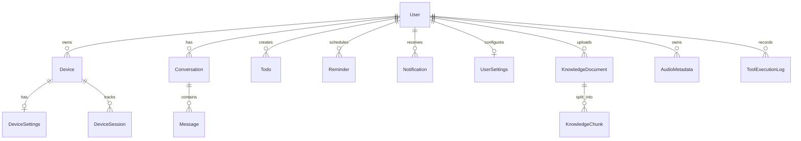

# MongoDB Database Schema Specification

## 1. Collections & Relationships

---

## 2. Models Specification

### User (`users`)
- `_id`: ObjectId
- `name`: String
- `email`: String (Unique index)
- `passwordHash`: String
- `role`: 'admin' | 'user' | 'device'
- `isActive`: Boolean
- `language`: String (default 'en')
- `timezone`: String (default 'Asia/Yangon')
- `telegramChatId`: String (Sparse index)
- `refreshTokenHash`: String (Select: false)
- `timestamps`: true

### Device (`devices`)
- `_id`: ObjectId
- `userId`: ObjectId (Ref User)
- `name`: String
- `deviceType`: 'esp32-s3' | 'simulator'
- `status`: 'online' | 'offline' | 'updating' | 'error'
- `apiKeyHash`: String (Select: false)
- `firmwareVersion`: String
- `hardwareVersion`: String
- `macAddress`: String (Unique index)
- `config`: { audioSampleRate, audioChunkSize, volumeLevel, brightnessLevel, ledEnabled }
- `capabilities`: { hasMicrophone, hasSpeaker, hasTouchSensor, hasLED, hasDisplay }

### AudioMetadata (`audiometadatas`)
- `_id`: ObjectId
- `userId`: ObjectId
- `deviceId`: ObjectId
- `conversationId`: ObjectId
- `fileName`: String
- `mimeType`: String
- `storageRef`: String (GridFS ObjectId)
- `storageType`: 'gridfs' | 's3'
- `duration`: Number
- `fileSize`: Number
- `audioType`: 'user_input' | 'ai_response' | 'uploaded'

### KnowledgeChunk (`knowledgechunks`)
- `_id`: ObjectId
- `documentId`: ObjectId
- `userId`: ObjectId
- `content`: String (Text index)
- `chunkIndex`: Number
- `tokenCount`: Number
- `embedding`: Array<Number> (Vector Search index: 768 dimensions)

