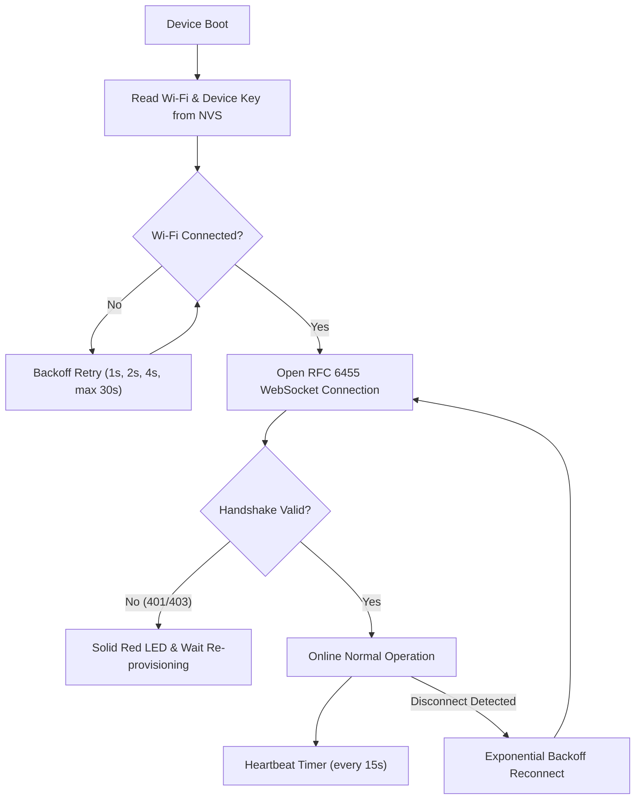

# ESP32-S3 Firmware Integration Specification

> **Target Device:** ESP32-S3 (ESP32-S3-WROOM-1 / ESP32-S3-DevKitC-1)  
> **Development Frameworks Supported:** ESP-IDF (v5.x recommended) or Arduino-ESP32  
> **Protocols:** Native WebSocket (RFC 6455) for bidirectional audio streaming, JSON control events, and RFID educational learning; HTTP REST fallback  

---

## 1. System Overview & Hardware Architecture

The physical robot device is powered by an **ESP32-S3 dual-core Xtensa LX7 processor** with 8MB/16MB Octal SPI Flash and 8MB Octal PSRAM.

```
       +---------------------------------------------------------+
       |                     ESP32-S3 ROBOT                      |
       |                                                         |
       |  [I2S IN]  <-- INMP441 / ICS-43434 MEMS Microphone      |
       |  [I2S OUT] --> MAX98357A I2S DAC / Class-D Amplifier    |
       |  [TOUCH]   <-- Head Capacitive Touch Sensor (GPIO 1)    |
       |  [SPI 1]   <-- RC522 RFID Reader (MIFARE Classic 1K)    |
       |  [SPI 2]   --> ST7789 240x240 LCD Screen                |
       |  [GPIO]    <-- Volume Up / Down Push Buttons            |
       |  [GPIO/RMT]--> WS2812B RGB Status NeoPixel LED          |
       |  [Wi-Fi]   <--> 802.11 b/g/n (2.4 GHz)                  |
       +---------------------------------------------------------+
                                 │
                     Native WebSocket (RFC 6455)
                                 │
                                 ▼
                     Node.js Fastify Backend
                   (ws://<host>:3000/ws/esp32)
```

---

## 2. Real-Time Communication Architecture

### Native WebSocket vs Socket.IO
- **The ESP32-S3 connects via RFC 6455 Native WebSocket.**
- **DO NOT use Socket.IO on the ESP32.** Socket.IO involves heavy handshake overhead, polling fallbacks, and packet framing that wastes microcontroller CPU and RAM.
- **Endpoint:** `ws://<server_host>:3000/ws/esp32` (or `wss://` over TLS in production via Caddy reverse proxy)
- **Handshake Headers:**
  ```http
  GET /ws/esp32 HTTP/1.1
  Host: api.yourdomain.com
  Upgrade: websocket
  Connection: Upgrade
  Sec-WebSocket-Key: <base64-key>
  Sec-WebSocket-Version: 13
  x-device-id: 6732948271049281a10b90c1
  x-device-key: rbt_a8f902b1c8e7d6...
  ```
  *(Alternatively, query parameters `ws://<host>:3000/ws/esp32?deviceId=...&key=...` can be used during initial Wi-Fi captive portal setup).*

---

## 3. Audio Streaming Specifications

| Parameter | Input (Microphone → Backend) | Output (Backend → Speaker) |
|---|---|---|
| **Encoding** | Uncompressed Linear PCM | Uncompressed Linear PCM |
| **Bit Depth** | 16-bit Signed Little-Endian | 16-bit Signed Little-Endian |
| **Sample Rate** | 16,000 Hz (16 kHz) | 24,000 Hz (24 kHz) or 16,000 Hz |
| **Channels** | 1 (Mono) | 1 (Mono) |
| **Chunk Size** | 4,096 bytes (128 ms of audio) | 4,096 bytes progressive frames |
| **Transmission** | **Binary WebSocket Frame (`0x2`)** | **Binary WebSocket Frame (`0x2`)** |

> **IMPORTANT:**
> Continuous raw audio MUST be transmitted directly as binary WebSocket frames without JSON wrapping. This reduces transmission overhead to zero bytes of packaging.

---

## 4. Message Protocols (JSON Text Frames)

Text frames are UTF-8 encoded JSON objects containing `{ "event": string, "data": object }`.

### 4.1 Device Connect & Heartbeat

#### Connect Acknowledgment (Backend → ESP32)
Sent by backend immediately upon valid WebSocket handshake:
```json
{
  "event": "device:connected",
  "timestamp": 1731345600000,
  "data": {
    "deviceId": "6732948271049281a10b90c1",
    "serverTime": 1731345600000,
    "sampleRate": 16000,
    "chunkSize": 4096,
    "heartbeatInterval": 15
  }
}
```

#### Heartbeat Telemetry (ESP32 → Backend)
Sent every 15 seconds:
```json
{
  "event": "device:heartbeat",
  "data": {
    "freeHeap": 218492,
    "uptimeSeconds": 1420,
    "wifiRSSI": -58,
    "cpuTemp": 42.5,
    "batteryLevel": 88
  }
}
```

---

### 4.2 Feature C — Hands-Free Wake-Word Voice Assistant Lifecycle

#### Wake-Word Architecture & Responsibility
- **Wake-word detection runs locally on ESP32-S3 firmware** (e.g. using ESP-SR / WakeNet neural network on Xtensa LX7 AI vector instructions).
- **Continuous microphone audio is NOT streamed to the cloud for wake-word detection.**
- Audio streaming to the backend begins **ONLY after** the ESP32-S3 detects the wake word locally.
- When the voice turn completes, firmware returns to local wake-word detection. The child can speak again hands-free at any time without pressing buttons.

#### Conversation Lifecycle Diagram
```
ESP32-S3 (Microphone & Speaker)                      Backend (Gemini Live Engine)
       │                                                         │
[Local Wake Word Detected!]                                      │
       ├──── JSON { event: "audio:start" } ─────────────────────>│ (State: 'listening')
       │                                                         │
       ├──── Binary PCM Frame [4096 bytes @ 16kHz] ─────────────>│ (Forward to Gemini Live)
       ├──── Binary PCM Frame [4096 bytes @ 16kHz] ─────────────>│
       │                                                         │
       ├──── JSON { event: "audio:end", totalChunks: 24 } ──────>│ (State: 'thinking')
       │                                                         │ [Signals Gemini turnComplete]
       │<─── JSON { event: "audio:response:start" } ─────────────┤ (State: 'speaking')
       │<─── Binary PCM Frame [24kHz audio] ─────────────────────┤
       │<─── Binary PCM Frame [24kHz audio] ─────────────────────┤
       │<─── JSON { event: "audio:response:end" } ───────────────┤ (State: 'idle')
       │                                                         │
[Resume Local Wake-Word Listening]                               │
```

#### Audio Start (ESP32 → Backend)
Sent immediately upon wake-word detection:
```json
{
  "event": "audio:start",
  "data": {
    "sessionId": "voice_6732948271049281a10b90c1_1731345610000",
    "format": "pcm_16bit",
    "sampleRate": 16000,
    "channels": 1
  }
}
```

#### Binary Audio Chunks (ESP32 → Backend)
Streamed progressively as raw binary frames (Opcode `0x2`), each containing 4096 bytes (128 ms of 16-bit 16kHz PCM audio).

#### Audio End (ESP32 → Backend)
Sent when local Voice Activity Detection (VAD) detects silence after user finishes speaking:
```json
{
  "event": "audio:end",
  "data": {
    "totalChunks": 24,
    "totalDuration": 3.072
  }
}
```

#### Audio Response (Backend → ESP32)
1. **Header Frame (JSON):**
   ```json
   {
     "event": "audio:response:start",
     "timestamp": 1731345612500,
     "data": {
       "sessionId": "voice_6732948271049281a10b90c1_1731345610000",
       "format": "pcm_16bit",
       "sampleRate": 24000,
       "channels": 1
     }
   }
   ```
2. **Audio Chunks:** Sent as raw binary WebSocket frames (24kHz 16-bit signed PCM). ESP32 routes them directly to I2S DMA.
3. **Response End Frame (JSON):**
   ```json
   {
     "event": "audio:response:end",
     "timestamp": 1731345615000,
     "data": {
       "sessionId": "voice_6732948271049281a10b90c1_1731345610000",
       "duration": 2500
     }
   }
   ```

#### Barge-In Interruption (Backend → ESP32)
If the user speaks while the robot is speaking:
```json
{
  "event": "audio:cancel",
  "data": {
    "reason": "interruption"
  }
}
```
**ESP32 Action:** Immediately abort DMA playback buffer and switch LED state to listening.

---

### 4.3 Feature A — RFID Educational Learning System Protocol

#### Overview & Security Contract
- **Hardware:** RC522 RFID module connected via SPI, reading MIFARE Classic 1K cards.
- **Card Purpose:** Educational learning topics for children (Fruits, Animals, Colors, Numbers, Shapes, Letters, Everyday Objects, Science).
- **CRITICAL:** Educational content is stored on the RFID card itself. **This is NOT a family-member identification or resident access system.** The RFID UID is used solely for scan deduplication and diagnostics, never to determine family identity.
- **Untrusted Input Protection:** Card text is treated strictly as untrusted input. The backend neutralizes prompt injection and system override attempts.

#### Card Data Format (Stored on Card & Sent to Backend)
Cards store a compact JSON payload in MIFARE data sectors:
```json
{
  "schemaVersion": "1.0",
  "cardType": "fruits",
  "language": "my",
  "title": "ပန်းသီး",
  "category": "fruits",
  "description": "အနီရောင်ရှိပြီး ချိုမြိန်သော သစ်သီး",
  "facts": ["ဗီတာမင်စီ ကြွယ်ဝသည်", "ကျန်းမာရေးအတွက် အလွန်ကောင်းမွန်သည်"],
  "learningPrompt": "ပန်းသီးအကြောင်း ကလေးတွေအတွက် စိတ်ဝင်စားဖွယ် ရှင်းပြပေးပါ"
}
```

| Field | Type | Required | Description |
|---|---|---|---|
| `schemaVersion` | String | Yes | Version of card data structure (current: `"1.0"`) |
| `cardUid` | String | Optional | 4-byte or 7-byte hex UID of physical card |
| `cardType` | String | Optional | Educational type (e.g. `"fruits"`, `"animals"`, `"educational"`) |
| `language` | String | Optional | Target language: `"my"` (Burmese) or `"en"` (English) |
| `title` | String | **Yes** | Topic name (e.g. `"ပန်းသီး"` or `"Apple"`), max 100 chars |
| `category` | String | **Yes** | Educational category (e.g. `"fruits"`, `"animals"`), max 50 chars |
| `description` | String | Optional | Short card description, max 500 chars |
| `facts` | String[] | Optional | Array of facts (max 10 items, each max 200 chars) |
| `learningPrompt` | String | Optional | Specific prompt or question, max 300 chars |

#### Scan Event Request (ESP32 → Backend)
When the RC522 detects an educational card, the firmware reads the sectors, decodes the payload, and sends:
```json
{
  "event": "rfid:scan",
  "data": {
    "cardUid": "04A1B2C3D4",
    "cardData": {
      "schemaVersion": "1.0",
      "cardType": "fruits",
      "language": "my",
      "title": "ပန်းသီး",
      "category": "fruits",
      "description": "အနီရောင်ရှိပြီး ချိုမြိန်သော သစ်သီး",
      "facts": ["ဗီတာမင်စီ ကြွယ်ဝသည်", "တစ်နေ့လျှင် ပန်းသီးတစ်လုံးစားပါက ဆရာဝန်နှင့် ဝေးဝေးနေနိုင်သည်"]
    }
  }
}
```
*(Note: `cardData` can also be sent as a stringified JSON string).*

#### Immediate Scan Acknowledgment (Backend → ESP32)
```json
{
  "event": "rfid:scan:result",
  "timestamp": 1731345620000,
  "data": {
    "scanId": "rfid_6732948271049281a10b90c1_1731345620000",
    "cardUid": "04A1B2C3D4",
    "title": "ပန်းသီး",
    "category": "fruits",
    "language": "my",
    "status": "processing"
  }
}
```

#### Learning Content & Display Response (Backend → ESP32)
Contains the child-friendly explanation (ages 5–10) generated by Gemini:
```json
{
  "event": "rfid:learning:start",
  "timestamp": 1731345621200,
  "data": {
    "scanId": "rfid_6732948271049281a10b90c1_1731345620000",
    "cardUid": "04A1B2C3D4",
    "title": "ပန်းသီး",
    "category": "fruits",
    "language": "my",
    "text": "ပန်းသီးဟာ အလွန်အရသာရှိပြီး အာဟာရပြည့်ဝတဲ့ သစ်သီးတစ်မျိုးဖြစ်ပါတယ်။ အနီ၊ အစိမ်းနဲ့ အဝါရောင်တွေ ရှိပြီး ဗီတာမင်စီ ကြွယ်ဝစွာ ပါဝင်ပါတယ်။ တစ်နေ့ကို ပန်းသီးတစ်လုံး စားပေးရင် ကျန်းမာပျော်ရွှင်စေပါတယ် ကလေးတို့ရေ!",
    "hasAudio": true,
    "audioFormat": "pcm_16bit",
    "sampleRate": 16000
  }
}
```
**ESP32 Action:**
1. Display the topic `title` and explanation `text` on the ST7789 LCD screen.
2. If `hasAudio: true`, prepare I2S DMA for progressive PCM audio playback.

#### Binary Audio Streaming (Backend → ESP32)
If `hasAudio: true`, the backend streams synthesized speech PCM chunks as binary WebSocket frames (`0x2`).

#### Learning End Frame (Backend → ESP32)
```json
{
  "event": "rfid:learning:end",
  "timestamp": 1731345623000,
  "data": {
    "scanId": "rfid_6732948271049281a10b90c1_1731345620000",
    "cardUid": "04A1B2C3D4",
    "durationMs": 1800,
    "totalAudioChunks": 14
  }
}
```

#### RFID Error Event (Backend → ESP32)
Sent if validation fails or an error occurs:
```json
{
  "event": "rfid:error",
  "timestamp": 1731345620100,
  "data": {
    "code": "DUPLICATE_SCAN",
    "message": "Same card scanned repeatedly within debounce window. Ignored.",
    "cardUid": "04A1B2C3D4"
  }
}
```

##### Supported Error Codes:
- `INVALID_CARD_DATA`: Missing required fields (title, category) or malformed payload.
- `UNSUPPORTED_SCHEMA_VERSION`: Card schema version is not supported (only `"1.0"`).
- `PAYLOAD_TOO_LARGE`: Card payload exceeds maximum limit (4096 bytes).
- `DUPLICATE_SCAN`: Card scanned again within the 5-second debounce window.
- `AI_GENERATION_FAILED`: Backend AI generation service temporarily unavailable.

---

## 5. Hardware Event Handling

### 5.1 Feature B — Head Capacitive Touch Sensor Interaction

#### Behavior & Responsibilities
- **Pin:** GPIO 1 / Touch Pad 1
- **CRITICAL ARCHITECTURAL CONTRACT:**
  - **Head touch is strictly NOT a Push-to-Talk button.**
  - **Head touch MUST NOT:**
    - Start a Gemini voice session.
    - Start microphone streaming.
    - Stop microphone streaming.
    - Trigger an AI request.
    - Create a voice conversation.
    - Change the robot into listening mode.
- **Local Reaction:**
  - When a child touches or pats the robot's head, the **ESP32-S3 firmware immediately plays a short, preloaded, cute reaction sound stored locally in Flash/SPIFFS.**
  - The sound is played locally with zero network latency and zero AI token cost.
- **Backend Telemetry (Optional):**
  - ESP32 optionally reports the touch event to the backend for dashboard telemetry and interaction metrics only:
    ```json
    {
      "event": "touch:event",
      "data": {
        "pad": 1,
        "pressed": true
      }
    }
    ```
  - The backend logs the event and broadcasts it to the dashboard. The backend **guarantees** that receiving a touch event will never start a voice session or change the robot into listening state.

---

### 5.2 Physical Volume Buttons
- **Volume Up (GPIO 41) / Volume Down (GPIO 42)**
- Intercepted on ESP32 via GPIO interrupt, hardware amplifier gain adjusted locally, and telemetry event synced to backend:
  ```json
  {
    "event": "sensor:update",
    "data": {
      "volumeButtonState": "up",
      "currentVolume": 85
    }
  }
  ```

---

### 5.3 Robot Status LED (NeoPixel WS2812B)
- **Idle:** Soft Cyan Breathing (PWM pulse)
- **Listening (Wake Word Triggered):** Solid Green
- **Thinking (AI Processing):** Rotating Yellow Animation
- **Speaking (Voice / RFID response):** Pulsing Blue
- **RFID Card Detected:** White Flash once, then transition to Yellow (Thinking) / Blue (Speaking)
- **Error / Offline:** Red Blink

---

### 5.4 ST7789 240x240 LCD Screen
- **Default State:** Animated robot face (eyes blinking / smiling).
- **RFID Scan State:** Displays the scanned card title (e.g. `ပန်းသီး` / `Apple`), category badge, and scrolls the child-friendly educational text.

---

## 6. Wi-Fi Reconnection & Error Recovery Strategy



---

## 7. Firmware Integration Steps & Environment Configuration

### Firmware Implementation Checklist:
1. **SPI Bus 1:** Initialize RC522 RFID reader with MIFARE Classic 1K reader library.
2. **SPI Bus 2:** Initialize ST7789 240x240 LCD display for Unicode/Burmese text rendering.
3. **Capacitive Touch:** Configure GPIO 1 threshold interrupt to trigger local cute sound playback from flash via I2S DAC.
4. **Local Wake Word:** Initialize ESP-SR / WakeNet on microphone I2S DMA.
5. **WebSocket Task:** Connect to `ws://<backend_ip>:3000/ws/esp32` using `x-device-id` and `x-device-key`.
6. **Voice Streaming:**
   - On wake word: send `{"event": "audio:start", ...}`, stream 4096-byte binary frames.
   - On silence timeout: send `{"event": "audio:end", ...}`.
   - Play response audio chunks received from backend.
7. **RFID Processing:**
   - On card detection: read sector JSON, send `{"event": "rfid:scan", ...}`.
   - On `rfid:learning:start`: render text on ST7789 screen and play speech if audio chunks follow.

### Required Backend Environment Variables:
```env
# Gemini AI Configuration
GEMINI_API_KEY=your_gemini_api_key
FAST_MODEL=gemini-3.5-flash-lite
VOICE_MODEL=gemini-3.8-live

# Fastify Server
PORT=3000
HOST=0.0.0.0
API_PREFIX=/api/v1

# Security & Limits
RATE_LIMIT_MAX=100
RATE_LIMIT_WINDOW=60000
```
