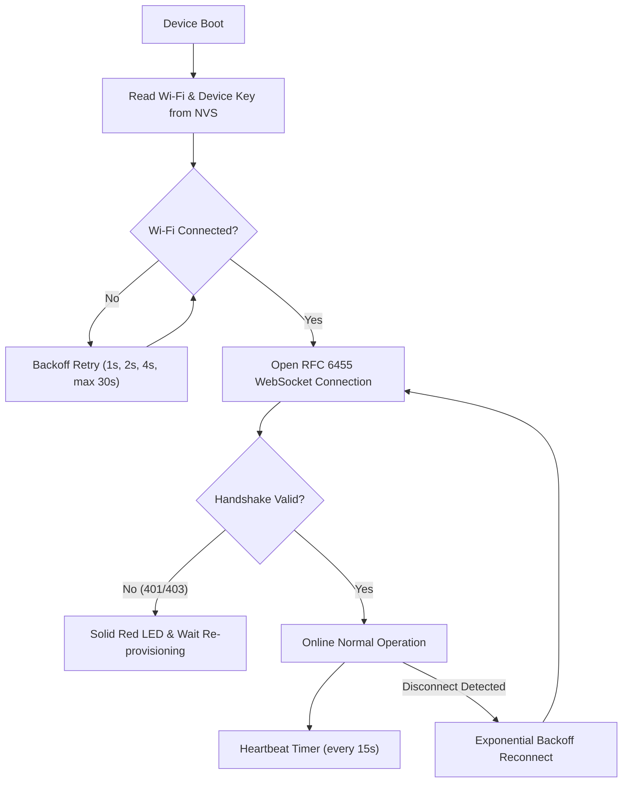

# ESP32-S3 Firmware Integration Specification

> **Target Device:** ESP32-S3 (ESP32-S3-WROOM-1 / ESP32-S3-DevKitC-1)  
> **Development Frameworks Supported:** ESP-IDF (v5.x recommended) or Arduino-ESP32  
> **Protocols:** Native WebSocket (RFC 6455) for bidirectional audio streaming, MQTT for lightweight events  

---

## 1. System Overview & Hardware Architecture

The physical robot device is powered by an **ESP32-S3 dual-core Xtensa LX7 processor** with 8MB/16MB Octal SPI Flash and 8MB Octal PSRAM.

```
       +---------------------------------------------------------+
       |                     ESP32-S3 ROBOT                      |
       |                                                         |
       |  [I2S IN]  <-- INMP441 / ICS-43434 MEMS Microphone      |
       |  [I2S OUT] --> MAX98357A I2S DAC / Class-D Amplifier    |
       |  [TOUCH]   <-- Capacitive Touch Sensor (T1 / GPIO 1)    |
       |  [GPIO]    <-- Volume Up / Down Push Buttons            |
       |  [GPIO/RMT]--> WS2812B RGB Status NeoPixel LED          |
       |  [SPI]     --> ST7789 240x240 LCD Screen                |
       |  [Wi-Fi]   <--> 802.11 b/g/n (2.4 GHz)                  |
       +---------------------------------------------------------+
                                 │
                     Native WebSocket (RFC 6455)
                                 │
                                 ▼
                     Node.js Fastify Backend
                       (ws://<host>:3000/ws/esp32)
```

---

## 2. Real-Time Communication Architecture

### Native WebSocket vs Socket.IO
- **The ESP32-S3 connects via RFC 6455 Native WebSocket.**
- **DO NOT use Socket.IO on the ESP32.** Socket.IO involves heavy handshake overhead, polling fallbacks, and packet framing that wastes microcontroller CPU and RAM.
- **Endpoint:** `ws://<server_host>:3000/ws/esp32`
- **Handshake Headers:**
  ```http
  GET /ws/esp32 HTTP/1.1
  Host: api.yourdomain.com
  Upgrade: websocket
  Connection: Upgrade
  Sec-WebSocket-Key: <base64-key>
  Sec-WebSocket-Version: 13
  x-device-id: 6732948271049281a10b90c1
  x-device-key: rbt_a8f902b1c8e7d6...
  ```
  *(Alternatively, query parameters `ws://<host>:3000/ws/esp32?deviceId=...&key=...` can be used during initial Wi-Fi captive portal setup).*

---

## 3. Audio Streaming Specifications

| Parameter | Input (Microphone → Backend) | Output (Backend → Speaker) |
|---|---|---|
| **Encoding** | Uncompressed Linear PCM | Uncompressed Linear PCM |
| **Bit Depth** | 16-bit Signed Little-Endian | 16-bit Signed Little-Endian |
| **Sample Rate** | 16,000 Hz (16 kHz) | 24,000 Hz (24 kHz) or 16,000 Hz |
| **Channels** | 1 (Mono) | 1 (Mono) |
| **Chunk Size** | 4,096 bytes (128 ms of audio) | 4,096 bytes progressive frames |
| **Transmission** | **Binary WebSocket Frame (`0x2`)** | **Binary WebSocket Frame (`0x2`)** |

> **IMPORTANT:**
> Continuous raw audio MUST be transmitted directly as binary WebSocket frames without JSON wrapping. This reduces transmission overhead to zero bytes of packaging.

---

## 4. Message Protocols (JSON Text Frames)

Text frames are UTF-8 encoded JSON objects containing `{ "event": string, "data": object }`.

### 4.1 Device Connect & Heartbeat

#### Connect Acknowledgment (Backend → ESP32)
Sent by backend immediately upon valid WebSocket handshake:
```json
{
  "event": "device:connected",
  "timestamp": 1731345600000,
  "data": {
    "deviceId": "6732948271049281a10b90c1",
    "sampleRate": 16000,
    "chunkSize": 4096,
    "heartbeatInterval": 15
  }
}
```

#### Heartbeat Telemetry (ESP32 → Backend)
Sent every 15 seconds:
```json
{
  "event": "device:heartbeat",
  "data": {
    "freeHeap": 218492,
    "uptimeSeconds": 1420,
    "wifiRSSI": -58,
    "cpuTemp": 42.5,
    "batteryLevel": 88
  }
}
```

### 4.2 Voice Conversation Lifecycle

```
ESP32 (Microphone)                          Backend / Gemini Live
       │                                              │
       ├──── JSON { event: "audio:start" } ──────────>│ (State: 'listening')
       │                                              │
       ├──── Binary PCM Frame [4096 bytes] ──────────>│ (Direct streaming)
       ├──── Binary PCM Frame [4096 bytes] ──────────>│
       │                                              │
       ├──── JSON { event: "audio:end" } ────────────>│ (State: 'thinking')
       │                                              │
       │<─── JSON { event: "audio:response:start" } ──┤ (State: 'speaking')
       │<─── Binary PCM Frame [24kHz audio] ──────────┤
       │<─── Binary PCM Frame [24kHz audio] ──────────┤
       │<─── JSON { event: "audio:response:end" } ────┤ (State: 'idle')
```

#### Audio Start (ESP32 → Backend)
Triggered by Wake-Word or Touch Sensor Press:
```json
{
  "event": "audio:start",
  "data": {
    "sessionId": "voice_esp32_1731345610000",
    "format": "pcm_16bit",
    "sampleRate": 16000,
    "channels": 1
  }
}
```

#### Audio End (ESP32 → Backend)
Triggered by silence timeout (VAD) or Touch button release:
```json
{
  "event": "audio:end",
  "data": {
    "totalChunks": 24,
    "totalDuration": 3.072
  }
}
```

#### Barge-In Interruption (Backend → ESP32)
If the user starts speaking while the robot speaker is playing audio:
```json
{
  "event": "audio:cancel",
  "data": {
    "reason": "interruption"
  }
}
```
**ESP32 Action:** Stop DMA audio playback buffer immediately (`i2s_channel_disable` / zero buffer flush) and switch LED state back to listening.

---

## 5. Hardware Event Handling

### 5.1 Capacitive Touch Sensor
- **Pin:** GPIO 1 / Touch Pad 1
- **Event:**
  ```json
  {
    "event": "touch:event",
    "data": {
      "pad": 1,
      "pressed": true
    }
  }
  ```
- **Behavior:**
  - Short Tap: Toggle voice conversation (Push-to-Talk)
  - Long Press (3s): Force Wi-Fi re-provisioning mode

### 5.2 Physical Volume Buttons
- **Volume Up (GPIO 41) / Volume Down (GPIO 42)**
- Intercepted on ESP32 via GPIO interrupt, hardware amplifier gain adjusted locally, and telemetry event synced to backend:
  ```json
  {
    "event": "sensor:update",
    "data": {
      "volumeButtonState": "up",
      "currentVolume": 85
    }
  }
  ```

### 5.3 Robot Status LED (NeoPixel WS2812B)
- **Idle:** Soft Cyan Breathing (PWM pulse)
- **Listening (Recording):** Solid Green
- **Thinking (AI Processing):** Rotating Yellow Animation
- **Speaking (Playing response):** Pulsing Blue
- **Error / Offline:** Red Blink

---

## 6. Wi-Fi Reconnection & Error Recovery Strategy


